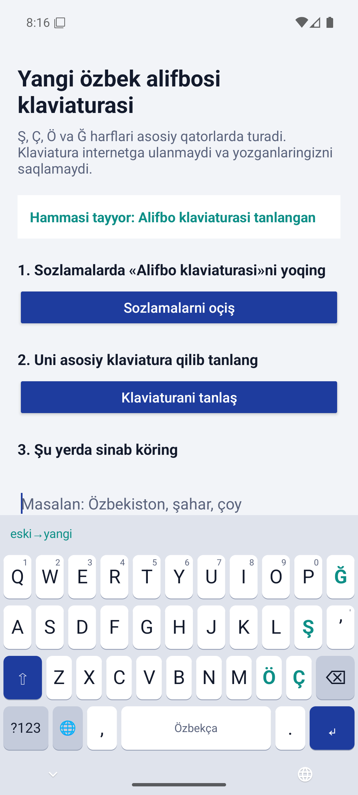
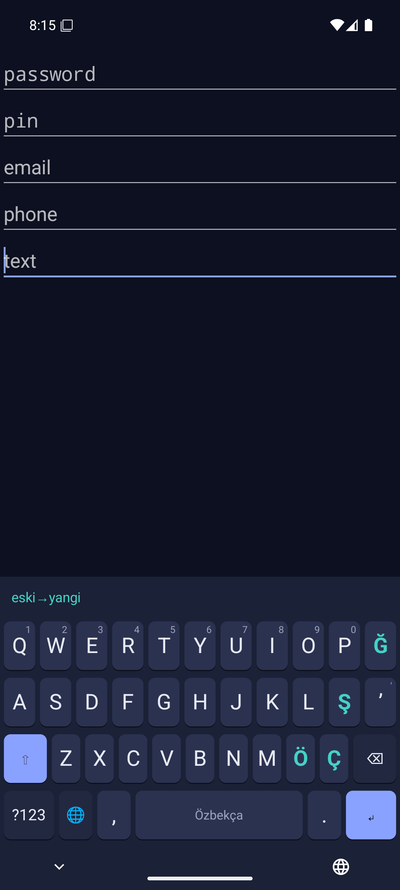

# Alifbo

[](https://github.com/uktamov-sh/alifbo/actions/workflows/ci.yml)

Klaviatura yangi özbek alifbosi uçun (21.10.2026 dagi O‘RQ-1184-son Qonun). Ş, Ç, Ö va Ğ harflari
asosiy qatorlarda turadi. Klaviatura internetga ulanmaydi va yozganlaringizni saqlamaydi.

Клавиатура для нового узбекского алфавита (закон O‘RQ-1184 от 21.10.2026). Буквы Ş, Ç, Ö и Ğ стоят
на основных рядах, а не прячутся под долгим нажатием. Клавиатура не подключается к интернету и не
сохраняет набранный текст.

<p>
  
  
</p>

## Что есть

- **Android-клавиатура** (`app`): узбекская и русская раскладки, подсказки слов, кнопка
  «eski→yangi», которая переписывает старую латиницу и кириллицу на новый алфавит. Android 8.0+.
- **Конвертер** (`converter`): библиотека на Kotlin без зависимостей. Правила описаны в
  [spec/converter-rules.md](spec/converter-rules.md).
- **Прототип** (`prototype`): страница, где можно попробовать раскладки Android и Windows и конвертер.

Раскладка для Windows ещё в работе.

## Безопасность

Клавиатура видит всё, что набирает человек, поэтому защита заложена в устройство приложения:

- У приложения нет ни одного разрешения, в том числе доступа в интернет. Сборка падает, если
  разрешение появится (задача `checkReleasePermissions`).
- В полях паролей и PIN-кодов клавиатура не читает текст вокруг курсора и ничего не подсказывает.
- Набранный текст не сохраняется и не пишется в журнал. Резервное копирование в облако запрещено.
- Нет аналитики, рекламы и сторонних библиотек.

## Сборка и тесты

Нужны JDK 17+ и Android SDK (API 36).

```bash
./gradlew :converter:test :app:testDebugUnitTest :app:assembleDebug
```

Конвертер на Kotlin и его JavaScript-копия в прототипе проверяются одними эталонами
[spec/cases.txt](spec/cases.txt):

```bash
node prototype/converter.test.js
```

То же самое запускается на GitHub Actions при каждом коммите. Готовые APK лежат в артефактах
сборки (`alifbo-apk`). Релизная APK пока без подписи.

## Лицензия

[GPL-3.0](LICENSE). Любая доработка этой клавиатуры тоже должна оставаться открытой, чтобы каждый
мог проверить, что она ничего не собирает.
